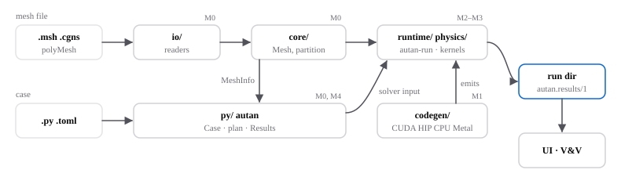
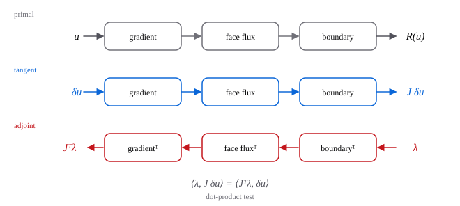

# Architecture

Autan is a C++ core, a kernel generator and a Python SDK that exchange documents with fixed schemas. This page shows how the parts fit; the [plan](../PLAN.md) gives the milestones, and the [README](../../README.md#done-and-planned) what is done.

## Components

| Directory | Role | Milestone |
|---|---|---|
| `io/` | Readers for Gmsh, Fluent, CGNS and OpenFOAM meshes. | M0 |
| `core/` | The face-based [mesh](meshes.md), FP64 geometry, partitioning and halos. | M0 |
| `py/` | The `autan` SDK and CLI: case schema, `plan`, `run`, results. | M0, M4 |
| `codegen/`, `kernels/` | Kernels written once, emitted for CUDA, HIP and CPU with their tangent and adjoint. | M1 |
| `physics/`, `solvers/` | Flux schemes, turbulence models, time stepping, linear solvers. | M2, M3 |
| `vv/`, `bench/` | Verification against manufactured solutions and reference data; bandwidth benchmarks. | M0 |

Components talk through three schemas, never through each other's internals: the [case](../contracts/case-schema.md) (`autan.case/1`), the [MeshInfo](../contracts/mesh-info.md) (`autan.mesh-info/1`) and the [run directory](../contracts/results.md) (`autan.results/1`).

## How Autan differentiates its kernels

The residual is a chain of loops over cells and faces. The generator differentiates the body of each loop and derives:

- the **tangent**, which runs the loops in the same order and gives the Jacobian-vector product used by the implicit solver;
- the **adjoint**, which runs the transposed loops in reverse order and gives the gradient of one output, such as drag, with respect to every input at the cost of about one extra solve.

In the adjoint, a loop that read from neighbouring cells writes to them, so the generator recomputes which loops conflict. The dot-product test checks that tangent and adjoint agree. The design and its alternatives are in [kernel generator research](../research/kernel-generator.md#4-automatic-differentiation). The tangent arrives with M1, the full adjoint with M6.

## Precision

Kernels compute in FP32 and accumulate updates, norms and geometry in FP64 (`fp32+acc64`); `fp64` computes everything in FP64. Every run records its precision.
