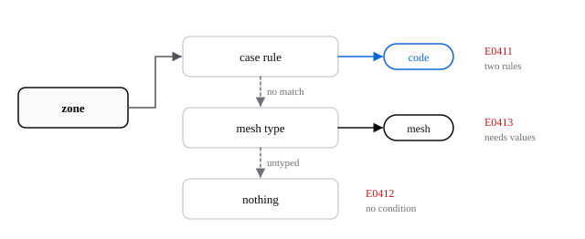

# Conditions aux limites

Chaque zone frontière du maillage qui a des faces doit avoir une condition avant qu'un calcul puisse démarrer. Autan la prend dans votre cas quand vous en donnez une, sinon dans le type que le fichier de maillage donne à la zone. `autan plan` affiche le résultat pour chaque zone, avec son origine : sa **provenance**.

## Comment une zone obtient sa condition

| Provenance | La condition vient de |
|---|---|
| `code` | Une règle de votre cas, comme `case.boundary("wing.*").wall()`. |
| `mesh` | Le type de la zone dans le fichier de maillage, comme un `wall` Fluent ou un `BCFarfield` CGNS. |
| `default` | Zones de cellules seulement : une zone que le maillage ne type pas est un fluide avec le milieu par défaut de la physique. |

Une règle peut remplacer le type du maillage ; `autan plan` signale alors `W0415` pour que le remplacement soit visible. Un type de maillage qui demande des valeurs que vous seul pouvez donner, comme la pression totale d'une entrée, arrête le plan avec `E0413`.

Les règles, dont la correspondance par motif glob et tous les codes d'erreur, sont dans [Schéma de cas : résolution des frontières](../contracts/case-schema.md#boundary-resolution). Les types de maillage normalisés sont dans [MeshInfo](../contracts/mesh-info.md#normalized-boundary-types).

## Pourquoi le maillage d'abord

Les mailleurs nomment et typent déjà les frontières. Lire ces types permet à un cas de ne dire que ce que le maillage ne peut pas savoir : les valeurs, et les zones que vous voulez traiter autrement. Afficher la provenance garantit qu'aucune condition n'est appliquée sans que vous voyiez d'où elle vient.

## Et ensuite

- [Vérifier un cas avant de le lancer](../guides/check-a-case.fr.md)
- [Codes de diagnostic](../sdk/errors.md)
