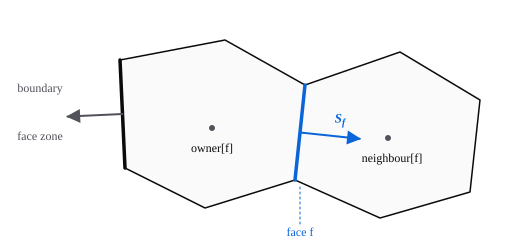
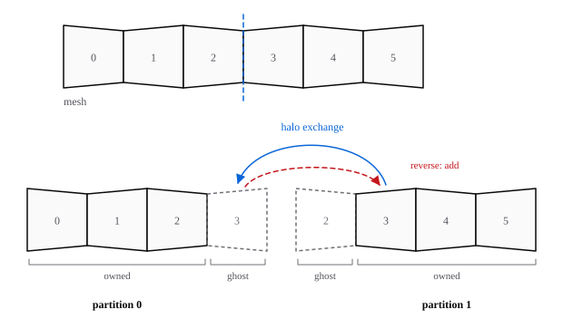

# Maillages

Autan lit tout maillage de cellules polyédriques et le stocke par ses faces. Une cellule n'est connue que par les faces qui la bordent : un tétraèdre, un hexaèdre et un polyèdre à 200 faces passent par le même code. Les tableaux, invariants et codes d'erreur exacts sont dans le [contrat de maillage](../contracts/mesh.md) (en anglais).

## Comment les faces relient les cellules

Chaque face stocke la cellule de chaque côté. La **propriétaire** (`owner`) est la cellule dont s'éloigne son vecteur surface ; la **voisine** (`neighbour`) est celle vers laquelle il pointe. Une face frontière a une propriétaire et pas de voisine, et son vecteur sort du domaine.

Un kernel de flux boucle sur les faces : il lit la propriétaire et la voisine, calcule un flux, l'ajoute à l'une et le retranche à l'autre. C'est pourquoi le solveur n'a besoin d'aucun type de cellule.

## Zones

Chaque face appartient à une **zone de faces** et chaque cellule à une **zone de cellules**. Les zones viennent du fichier de maillage : noms de zones Fluent, groupes physiques Gmsh, conditions aux limites et familles CGNS, patches OpenFOAM. Une zone garde son nom et, quand le fichier en donne un, son type, comme `wall` ou `farfield`.

Votre cas désigne les zones par leur nom. Le résumé [MeshInfo](../contracts/mesh-info.md) les liste, avec leurs types et tailles, pour que le SDK vérifie un cas sans charger le maillage.

## Pourquoi les cellules fantômes existent

Pour calculer sur plusieurs GPU, Autan découpe le maillage en partitions, une par GPU. Chaque partition stocke les cellules qu'elle **possède** (`owned`), puis des copies **fantômes** (`ghost`) des cellules de l'autre côté de la coupe, possédées par une autre partition.

Une face sur la coupe a une cellule possédée d'un côté et une fantôme de l'autre : la boucle sur les faces tourne sans changement. Avant la boucle, un échange de halo copie les valeurs possédées dans les fantômes. Après, les contributions ajoutées aux fantômes sont des sommes partielles : un échange inverse les ajoute à la partition propriétaire. L'adjoint a besoin de cet échange inverse ; voir [Architecture](architecture.fr.md#comment-autan-dérive-ses-kernels). [Partitioning and halo exchange](../design/partitioning.md) (en anglais) décrit le partitionneur et l'échange.

## Géométrie

Aires, centroïdes et volumes sont calculés une fois, en FP64, quelle que soit la précision de calcul du solveur. [Contrat de maillage : géométrie](../contracts/mesh.md#geometry) les définit.
