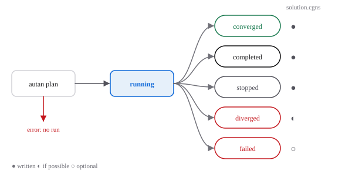

# Runs

A run is one execution of a case on a mesh. It writes one directory that holds everything needed to read, compare and reproduce it. The layout is the [results contract](../contracts/results.md); `autan.Results` reads it.

## Run states

`autan plan` runs first. If it finds an error, nothing is written. Otherwise the run starts in `running` and ends in one state:

| State | Meaning |
|---|---|
| `converged` | Every residual dropped by the requested number of orders. |
| `completed` | The iteration or time-step budget ran out first. |
| `stopped` | You, a signal or an execution cap stopped it. |
| `diverged` | The solution became non-finite or non-physical; a `D` diagnostic names the cell. |
| `failed` | The backend hit an unexpected error, `E0704`. |

## The run directory

| File | Written |
|---|---|
| `run.json` | At start, then at every state change. |
| `case.toml` | At start: the case as run, every default filled in. |
| `mesh-info.json` | At start: the MeshInfo of the mesh read. |
| `history.jsonl` | One line per recorded iteration, during the run. |
| `solution.cgns` | At the end, before the state leaves `running`. |

You can open a run while it is `running`: the history is readable, the solution is not.

## How runs are identified

Every run records the mesh hash, the case hash, the solver commit and the precision. Their combination, with the backend and the devices, is the run's `identity`. In the bitwise-deterministic mode, two runs with the same identity give the same bits; [run.json](../contracts/results.md#runjson) defines each field.
