# UI inspiration and visual direction

The web UI (milestone M10, `docs/PLAN.md`) has five screens: **Home** (runs and studies), **Setup** (preparing a case), **Live** (a run in progress), **Analysis** (3D results) and **Compare** (two or more runs). The current mockup is [`../ux-mockup.html`](../ux-mockup.html). This page records what we take from tools that do this well, then fixes the visual and interaction direction. Tokens live in [`tokens.css`](tokens.css); the UI and the docs site import that file.

The brief: **as little text as possible**. Shape, state, motion and the keyboard carry the meaning. Screens are full-bleed and immersive, not grids of cards.

## References

All screenshots are of public pages, captured headless on 2026-10-31; the source of each is in [Sources](#sources). They are third-party material kept here as design references.

### Vercel

The closest model for the run lifecycle: a deployment is a run, a project is a case.

| | |
|---|---|
| 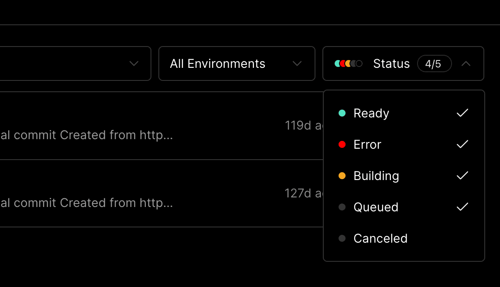 | 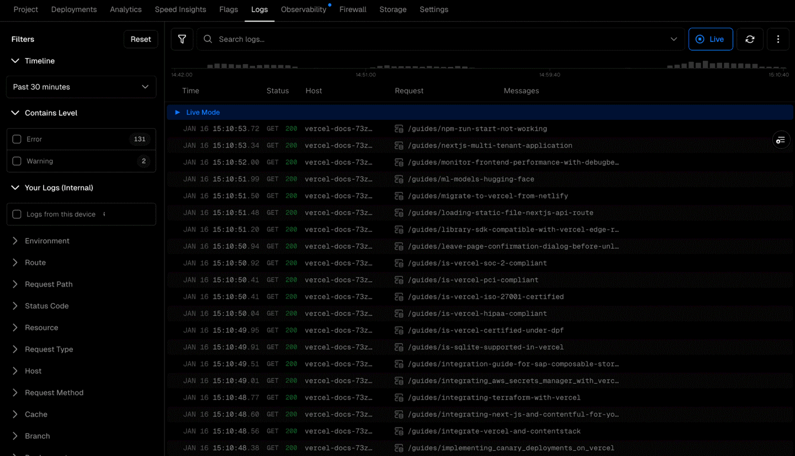 |
| 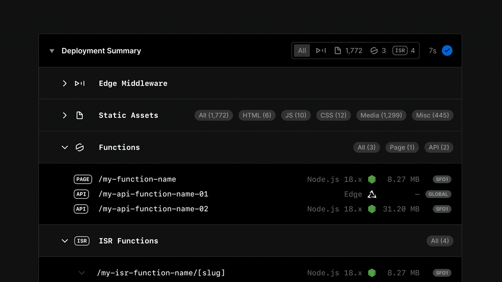 | 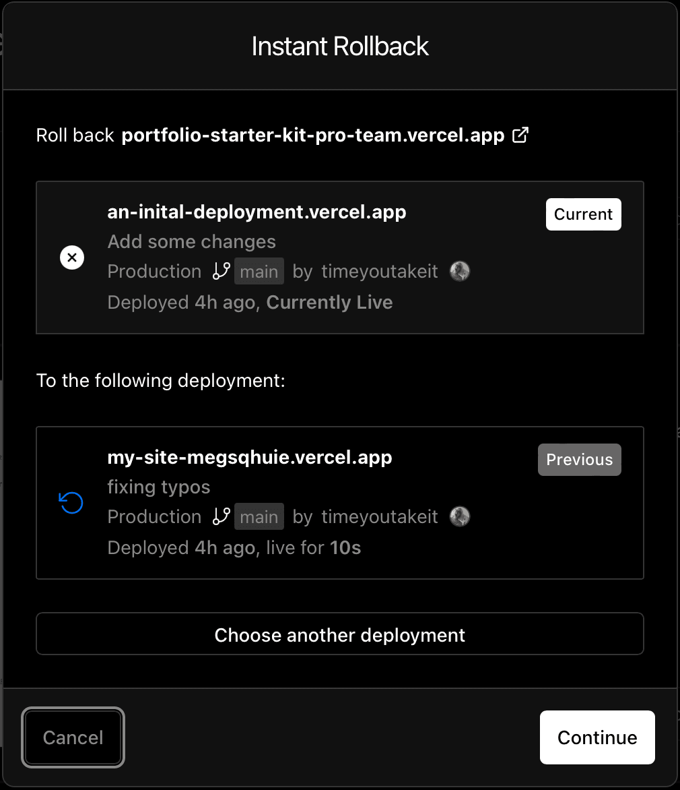 |

- **Run list as a dense table, one row per run** (Home). A row reads left to right: what changed, state dot with duration, target, short hash, branch, relative date, author. No card, no description. We use: case diff summary · state + wall time · GPUs and precision · mesh hash · relative date.
- **Filters are chips, and the state filter shows its colours** (Home). `Status 4/5` with the coloured dots in the trigger tells you what is hidden without opening it.
- **Search is anchored to the sidebar, not a centred modal.** In the signed-in dashboard, `Find` sits at the top of the sidebar and opens as a dropdown below it, mixing entities (projects, settings) and a natural-language question. We keep a centred ⌘K for actions and put entity search where the eye already is.
- **Detail page: a metadata grid, then collapsible sections** (Live, Analysis). Created · Status · Duration · Environment in one row; Summary, Checks, Domains folded below with a count or a state icon on the right. Our run header: Started · State · Iteration · GPUs · ETA; sections fold for Plan, Monitors, Outputs.
- **Live logs: a histogram timeline above a streamed table, and a Live toggle** (Live). The histogram shows where the errors are before you read a line. Ours plots residual and warnings per iteration above the solver log; scrolling up pauses Live, `End` resumes.
- **Empty states offer the next source** (all). Vercel's empty runtime-logs view points at request logs and CDN requests instead of explaining why it is empty.
- **Compare as "current vs. other", two stacked rows with a role badge** (Compare). `Current` / `Previous` tags beat a two-column table when you compare two runs.
- **Deployment summary rows: icon, monospace path, right-aligned metrics and a region chip** (Setup). The same anatomy fits boundary zones: zone name, BC type chip, face count, provenance.
- Also: [`vercel-deployment-resources`](screens/vercel-deployment-resources.png) (search + segmented filter + row actions menu), [`vercel-production-deployment`](screens/vercel-production-deployment.png) (preview thumbnail next to metadata), [`vercel-observability`](screens/vercel-observability.png) and [`vercel-speed-insights`](screens/vercel-speed-insights.png) (one big chart, a metric rail on the left, threshold lines), [`vercel-command-menu`](screens/vercel-command-menu.png) (results with the matched term highlighted, `Esc` hint).

### Linear

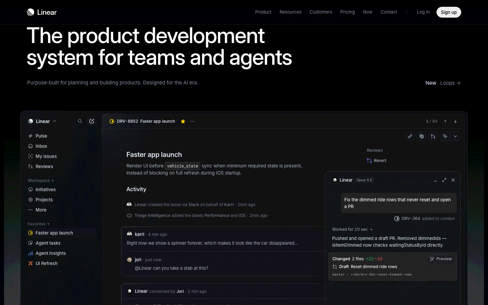

- **Keyboard first, everywhere** (all). Every action has a key, shown in menus and in the palette; `j`/`k` move, `x` selects, `Space` peeks.
- **Optimistic updates.** The UI changes before the server answers and reconciles quietly. For us: relabel a BC and the viewport recolours at once; `plan` re-runs in the background.
- **Low-contrast chrome, high-contrast content.** Sidebar and toolbars sit at `--fg-2`; the work is at `--fg`. [`linear-board`](screens/linear-board.png): columns with counts, no borders around cards beyond one hairline.

### Raycast

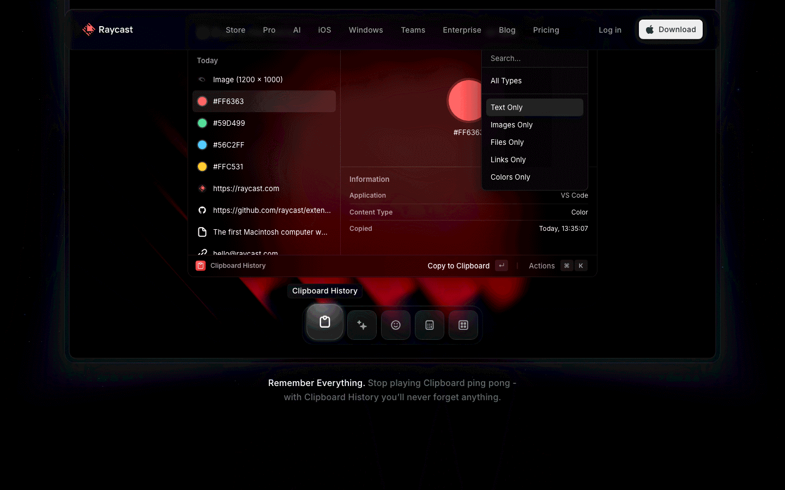

- **The palette is the app** (all). A list on the left, a detail pane on the right, an action bar at the bottom with the primary action and `⌘K` for more. Ours: type a case, run or command; the right pane previews (residual sparkline, thumbnail); `↵` opens, `⌘↵` runs.
- **Footer hints instead of help text.** Shortcuts teach themselves.

### Arc

Arc is being retired (arc.net now shows a farewell page), so no screenshot. We keep two ideas: the sidebar is the only navigation chrome, and a command bar replaces menus.

### Figma

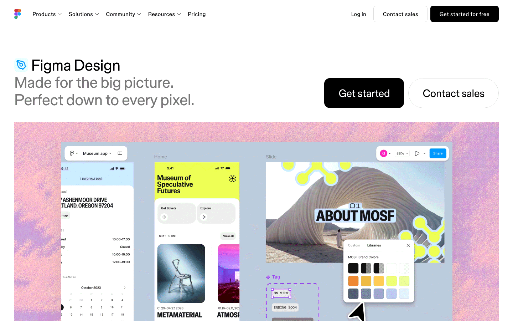

- **Canvas first, panels float** (Setup, Analysis). Inspector on the right reflects the selection; nothing selected shows the document properties.
- **Selection drives everything.** Click a surface in the viewport: the inspector shows its zone and BC, the code drawer highlights the matching line.

### Stripe

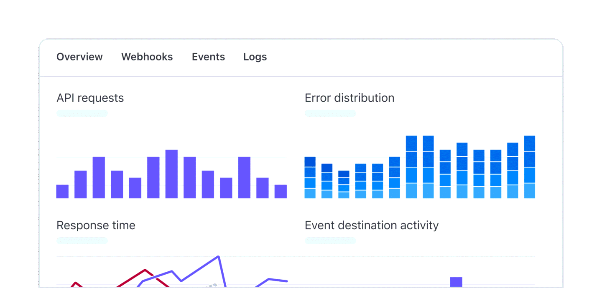

- **Workbench: a developer drawer docked to the bottom of every page** (all). Overview, Events, Logs, without leaving the screen. Our equivalent: `` ` `` opens a drawer with `case.py`, the solver log and the SDK call that reproduces the view.
- **Errors carry a code and a fix.** Matches the CLI's `E0412` style (`../dx.html`).

### Grafana

| | |
|---|---|
| 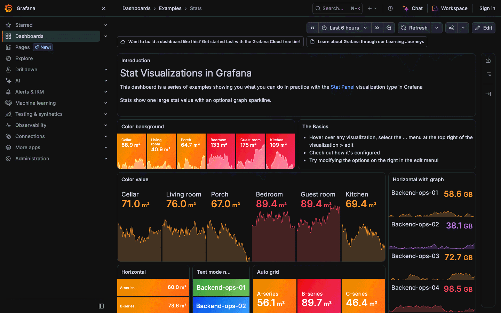 | 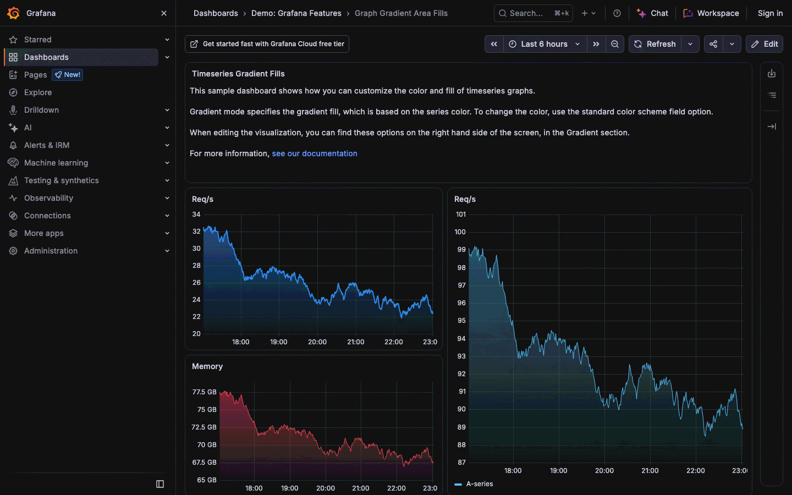 |

- **Stat with sparkline** (Live, Home). One big number, the trend behind it, a threshold colour. Used for CL, CD, residual drop and ns/cell/iteration.
- **Shared time cursor** across panels (Live, Compare): hover one chart, every chart shows the same iteration.
- **Time range and refresh as one control** (Live): `Last 6 hours · Refresh 30s`. Ours: iteration window + Live.
- [`grafana-command-palette`](screens/grafana-command-palette.png): results grouped by type (pages, folders, dashboards) with the breadcrumb in muted text.

### Weights & Biases

The nearest analogue to studies and comparisons.

| | |
|---|---|
| 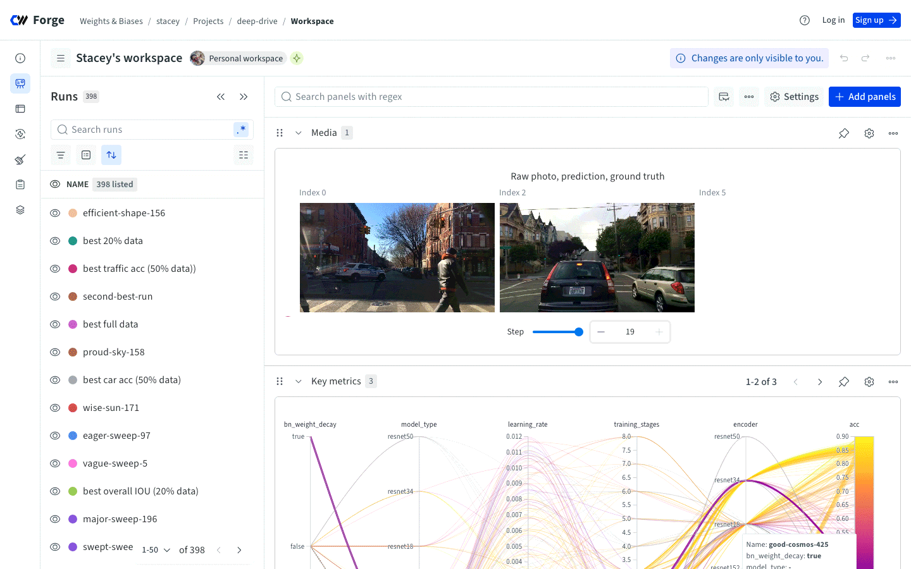 | 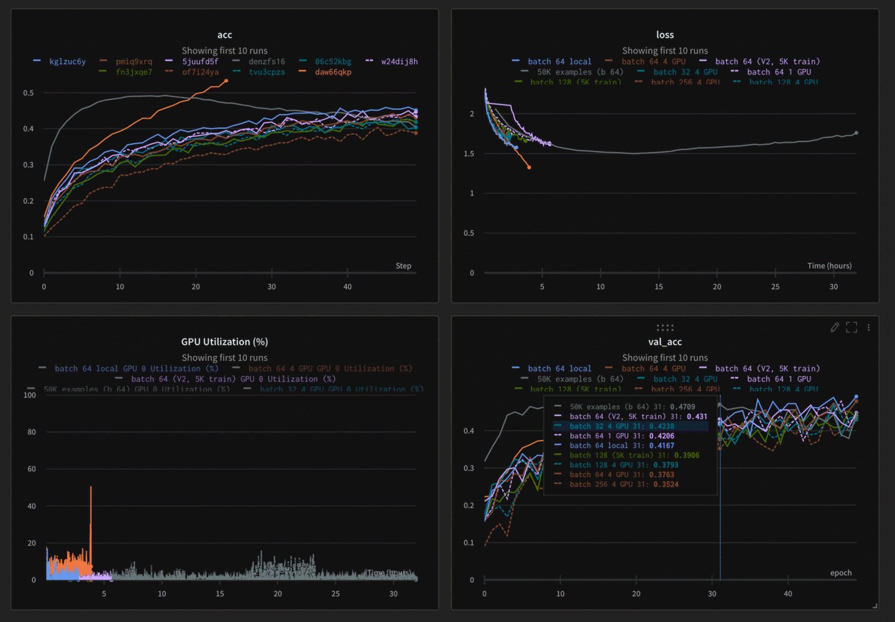 |

- **Runs table on the left, panels on the right, one colour per run** (Compare). The swatch next to the run name is the legend for every chart; the eye toggles visibility. We use the `--series-*` colours the same way.
- **Overlay curves of many runs on one chart** (Compare, Home for studies): residuals, CL vs. iteration.
- **Parallel coordinates for sweeps** (Home > study): Mach, AoA, mesh level and turbulence model on the axes, the objective last.

### Onshape

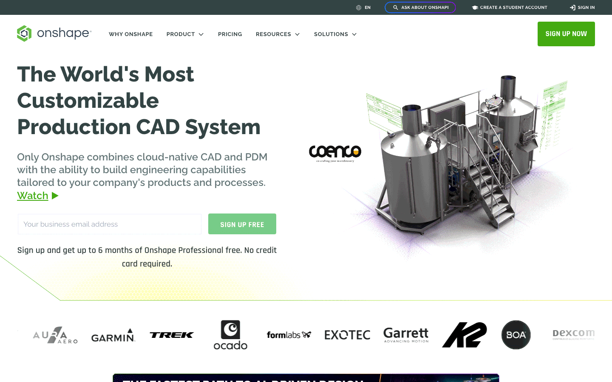

- **A full CAD tool in the browser with no install**, and a feature tree beside the model. Our Setup tree follows the case: Geometry, Mesh, Physics, Conditions, Run, Results, each with a state glyph.

### SimScale

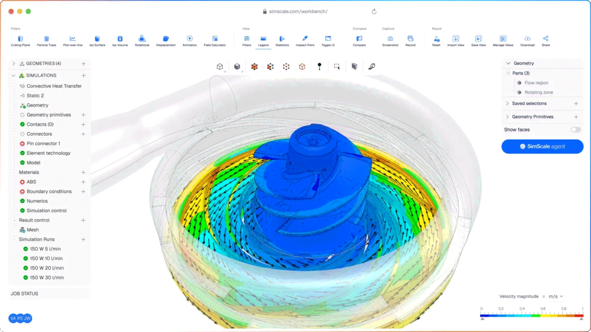

- **The setup tree uses state glyphs: green filled, red ring, grey empty** (Setup). Without reading a word you see that `Boundary conditions` and the material are incomplete. We take exactly this.
- **Colour legend bottom-right, small, with units** (Analysis).
- Avoid: the top toolbar of thirty labelled icons. Our tools live in the palette and on keys.

### ParaView Glance

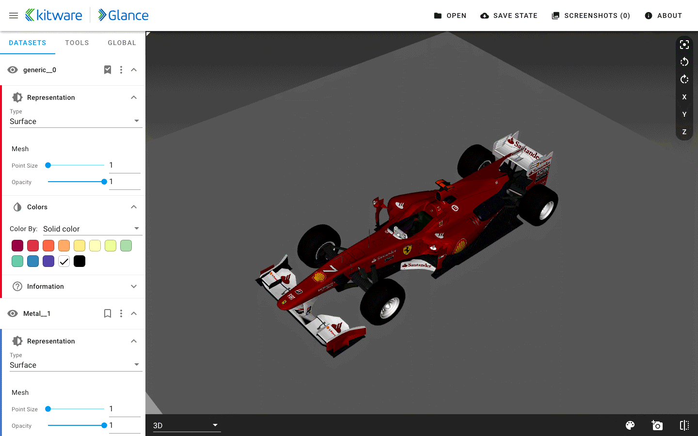

- **Pipeline as a stack of collapsible blocks per dataset** (Analysis): representation, colour by, opacity. Ours: one block per field layer (surface, slice, streamlines, iso-surface).
- **Camera presets on a thin rail at the viewport edge** (X, Y, Z, reset). Ours, with keys `1`–`6` for the six axis views and `f` to frame the selection.

### Not captured

Luminary Cloud publishes marketing pages only; its product UI is not public. We keep its principle from `../dx.html`: the SDK and the UI show the same case.

## Direction

### Principles

1. **Minimal text.** A label only when a glyph, position or colour cannot carry the meaning. No sentences in the chrome, no explanatory paragraphs, no tooltips as a crutch: if a control needs one, redesign it. Units and numbers stay; prose goes.
2. **The work fills the screen.** The viewport, the chart or the run table is the page. Panels float over the viewport on `--glass` with backdrop blur and fold away (`\` hides all chrome). No dashboard of cards.
3. **Keyboard first.** Everything is reachable from ⌘K; every frequent action has a single key, shown next to it in menus and the palette. `?` shows the full map. The mouse is for the viewport.
4. **Instant feedback.** Optimistic changes; local recomputation (`plan`, BC coverage) under 100 ms; no blocking spinner. Long work shows progress in place (the state dot, the row, the tab title).
5. **State is visible.** Every run, zone and setup step carries a state glyph. Colour is reserved for state and data; the chrome is greyscale.
6. **Motion explains change.** Motion says where something came from or what changed: a panel slides from its trigger, a changed value flashes once, a new log line fades in. Nothing loops except the live pulse. `prefers-reduced-motion` turns it off.
7. **Code is the source of truth.** Every UI action edits `case.py`; the drawer shows the diff. No hidden UI-only state.

### Tokens

Defined in [`tokens.css`](tokens.css), light and dark. Dark is the default for Live and Analysis (viewport contrast); Home and Compare follow the system theme.

| Group | Choice | Why |
|---|---|---|
| Type | Geist Sans for UI, Geist Mono for numbers, paths, code (both SIL OFL 1.1, self-hosted). Base 13 px; scale 11–32. Weights 400/500/600. `font-variant-numeric: tabular-nums` on every number. | Dense UI needs a compact sans; numbers must align in columns and not jitter while they update. |
| Neutrals | Five greys per theme: `--bg-0…3`, `--line`, `--line-strong`, `--fg`, `--fg-2`, `--fg-3`. | Chrome stays out of the way of the colour map. |
| Accent | One blue, `--accent`: focus, selection, primary action, running state. | A single accent keeps state colours readable. |
| Semantic | `--success` converged, `--warning` stalled or risky (W-codes), `--danger` diverged or error (E/D-codes), `--info` = accent. Each has a `-soft` fill. | Mirrors the CLI's coded messages. |
| Run states | `--state-queued`, `-planning`, `-running`, `-converged`, `-stalled`, `-diverged`, `-stopped`. | One glyph language for rows, tabs, tree and favicon. |
| Series | `--series-1…8`, assigned in order to compared runs and kept for the session. | Same run, same colour on every chart and in the 3D legend. |
| Field colour maps | Diverging: cool–warm (Moreland 2009) for signed fields (Cp, Δ). Sequential: viridis for magnitudes. Never jet/rainbow. | Perceptually uniform; readable in greyscale and by colour-blind users. |
| Density | 4 px grid; rows 32 px (28 compact); controls 28 px (36 for primary actions). | Tables of hundreds of runs fit on one screen. |
| Radii | 4 chips and inputs · 6 buttons and rows · 8 panels and popovers · 12 dialogs and palette. | Rounded enough to read as interactive, not soft. |
| Elevation | Borders and background steps first; shadows only on popovers and the palette. In dark mode the shadow includes a 1 px ring. | Shadows vanish on dark backgrounds. |
| Motion | 80 ms press · 120 ms hover · 180 ms popover · 240 ms panel; `--ease-out` for entry. Live pulse 2 s. | Fast enough to feel instant, slow enough to follow. |

### Components

- **State dot.** 8 px circle; hollow = queued, filled = done, pulsing = running, ring + `!` = diverged. Used in rows, tabs, the setup tree and the favicon.
- **Run row.** Dot · name · case diff summary (mono, muted) · wall time · GPUs × precision chip · mesh hash · relative date. `Space` peeks (residual sparkline + thumbnail), `↵` opens, `x` selects, `c` compares the selection.
- **Study row.** A run row that expands into its member runs; the right edge shows the objective as a sparkline across the sweep.
- **Filter chips.** `State`, `Case`, `Mesh`, `Precision`, `Author`; the trigger shows the active values as dots or a count.
- **Command palette (⌘K).** Centred, 640 px, top third. Grouped results (cases, runs, commands, docs), shortcut on each row, a preview pane on wide screens, an action bar at the bottom. Natural-language requests go to the agent, whose answer is a code diff to accept (as in the mockup).
- **Setup rail.** Steps with state glyphs (SimScale tree); `1`–`6` jump to a step.
- **Inspector.** Floating, right or left of the viewport, reflects the selection; collapsible blocks (ParaView Glance).
- **Code drawer.** `` ` `` toggles; shows `case.py` with the last change flashed, the log and a reproduce snippet (Stripe Workbench).
- **Metric tile.** Big mono number + unit + sparkline + threshold colour (Grafana stat).
- **Live chart.** Residuals (log scale) and monitors, shared iteration cursor, Live toggle; scrolling back pauses.
- **Log stream.** Histogram timeline over a virtualised table; coded messages link to the cell in the viewport (`D0107` → `--at-cell`).
- **Viewport chrome.** Axis-view rail, colour legend bottom-right with units and range, a minimal status line (cells, iteration, FPS) in mono.
- **Compare header.** Runs as coloured chips with a role (`A`/`B`, or reference); 3D compare shows A | B | Δ with synced cameras.

### Screens

| Screen | Layout | Keys |
|---|---|---|
| Home | Sidebar (Find at top) + full-width run/study table, filter chips above, stat strip for the selection. | `/` filter, `j`/`k`, `Space`, `↵`, `x`, `c`, `n` new case |
| Setup | Full-bleed viewport, setup rail left, inspector floating, code drawer right. Missing BCs glow on the model. | `1`–`6`, `b` assign BC, `p` plan, `⌘↵` run |
| Live | Run header grid, residual chart and metric tiles over the viewport (fields update as snapshots arrive), log stream in the drawer. | `l` live, `s` stop, `End` resume follow |
| Analysis | Viewport only; inspector with field layers; legend; probes and slices from the palette. | `f` frame, `1`–`6` views, `[`/`]` cycle field |
| Compare | Runs table with series swatches left, overlaid charts right; `v` switches to 3D A | B | Δ. | `v`, `d` case diff, `t` toggle run |

### What we avoid

- Grids of cards, hero headers, sentences explaining a control.
- Colour used for decoration, coloured chrome, gradients on surfaces; rainbow colour maps.
- Modal wizards and confirmation dialogs; prefer undo (`⌘Z`) and inline state.
- Spinners without progress, toasts for what should be inline state.
- Toolbars of labelled icons; hidden shortcuts that only a cheat sheet reveals.
- Any UI state that cannot be expressed in `case.py`.

## Sources

| Screenshot | Source |
|---|---|
| `vercel-command-menu` | https://vercel.com/docs (⌘K search) |
| `vercel-deployment-resources`, `vercel-deployment-summary` | https://vercel.com/docs/deployments |
| `vercel-deployments-status-filter` | https://vercel.com/docs/deployments/managing-deployments |
| `vercel-logs-live` | https://vercel.com/docs/logs/runtime |
| `vercel-rollback-compare`, `vercel-production-deployment` | https://vercel.com/docs/instant-rollback |
| `vercel-observability` | https://vercel.com/docs/observability |
| `vercel-speed-insights` | https://vercel.com/docs/speed-insights |
| `linear-issue`, `linear-board` | https://linear.app/ |
| `raycast-window` | https://www.raycast.com/ |
| `figma-canvas` | https://www.figma.com/design/ |
| `stripe-workbench` | https://docs.stripe.com/workbench |
| `grafana-dashboard` | https://play.grafana.org/d/37Dq903mk/graph-gradient-area-fills |
| `grafana-stats` | https://play.grafana.org/d/Zb3f4veGk/stats |
| `grafana-command-palette` | https://play.grafana.org/ (⌘K) |
| `wandb-workspace` | https://wandb.ai/stacey/deep-drive/workspace (public project) |
| `wandb-compare` | https://wandb.ai/site/experiment-tracking/ |
| `onshape-home` | https://www.onshape.com/en/ |
| `simscale-workbench` | https://www.simscale.com/product/ |
| `paraview-glance-viewer` | https://kitware.github.io/glance/app/ (sample "Formula 1") |
